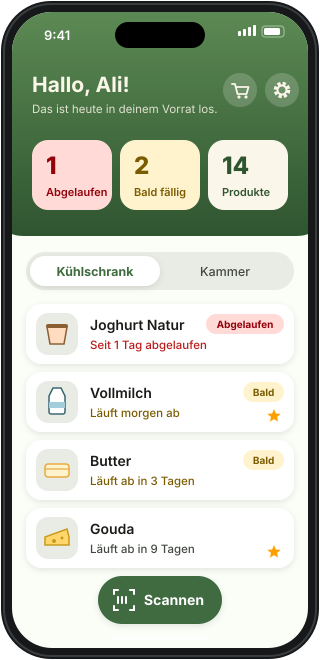
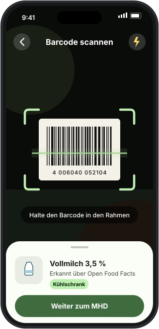
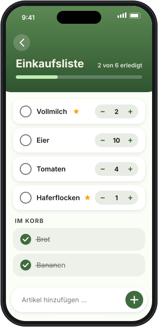
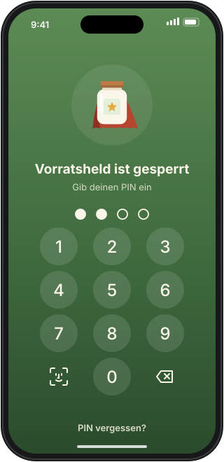
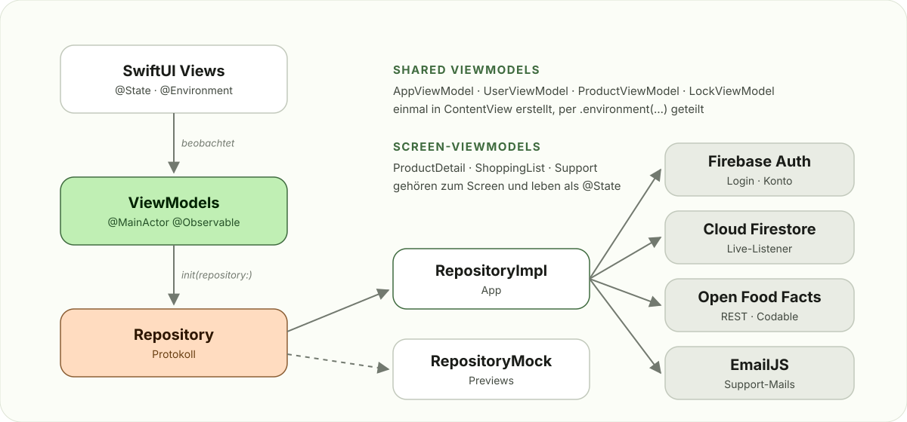

<p align="center">
  
</p>

<p align="center">
  
  
  
  
  
</p>

<p align="center">
  <b>Vorratsheld behält den Vorrat zu Hause im Blick.</b><br>
  Produkt scannen, Mindesthaltbarkeitsdatum mit der Kamera ablesen und rechtzeitig erinnert werden,<br>
  bevor etwas im Müll landet.
</p>

<p align="center">
  <a href="#einblick">Einblick</a> ·
  <a href="#funktionen">Funktionen</a> ·
  <a href="#architektur">Architektur</a> ·
  <a href="#tech-stack">Tech-Stack</a> ·
  <a href="#installation">Installation</a>
</p>

<br>

## Einblick

<table>
  <tr>
    <td align="center" width="25%"></td>
    <td align="center" width="25%"></td>
    <td align="center" width="25%"></td>
    <td align="center" width="25%"></td>
  </tr>
  <tr>
    <td align="center"><b>Übersicht</b><br><sub>Alles nach Ablauf sortiert</sub></td>
    <td align="center"><b>Barcode-Scan</b><br><sub>Daten von Open Food Facts</sub></td>
    <td align="center"><b>Einkaufsliste</b><br><sub>Live synchronisiert</sub></td>
    <td align="center"><b>App-Sperre</b><br><sub>Face ID oder PIN</sub></td>
  </tr>
</table>

## Funktionen

<table>
  <tr>
    <td width="50%" valign="top">
      <h3>Scannen statt tippen</h3>
      Den Barcode erkennt die Kamera über AVFoundation, Name und Bild kommen von Open Food Facts.
      Das MHD liest Apple Vision direkt von der Verpackung ab. Im Dunkeln hilft die Taschenlampe.
    </td>
    <td width="50%" valign="top">
      <h3>Immer wissen, was bald abläuft</h3>
      Die Übersicht trennt Kühlschrank und Kammer und färbt jedes Produkt nach Dringlichkeit ein.
      Drei Tage vor Ablauf kommt um 9 Uhr eine Erinnerung.
    </td>
  </tr>
  <tr>
    <td valign="top">
      <h3>Einkaufsliste, die mitdenkt</h3>
      Wird ein Favorit gelöscht, landet er automatisch auf der Liste. Abhaken, Menge ändern
      und wegwischen geht direkt in der Liste, der Fortschritt steht oben im Kopf.
    </td>
    <td valign="top">
      <h3>Geschützt mit Face ID</h3>
      Die App-Sperre nutzt Face ID oder Touch ID, mit eigenem PIN als Ersatz.
      Der PIN wird nur als Hash gespeichert, die Sperrzeit ist einstellbar.
    </td>
  </tr>
  <tr>
    <td valign="top">
      <h3>Live-Daten in der Cloud</h3>
      Vorrat und Einkaufsliste laufen über Snapshot-Listener in Firestore. Änderungen sind
      sofort auf allen Geräten da, auch in der Android-Version.
    </td>
    <td valign="top">
      <h3>10 Sprachen</h3>
      Die Sprache lässt sich direkt in der App umschalten, ohne Neustart.
      Arabisch wird von rechts nach links angezeigt.
    </td>
  </tr>
</table>

Dazu kommen Onboarding, Registrierung und Login, Profilbild, E-Mail und Passwort ändern, Konto löschen
und ein Hilfe-Formular, dessen Anfragen in Firestore und optional per Mail (EmailJS) ankommen.

## Architektur

<p align="center">
  
</p>

Die App folgt **MVVM** mit dem **Repository Pattern** und **Dependency Injection** über den Initializer.

| Schicht | Aufgabe |
|---|---|
| **View** | Zeigt nur an. Holt geteilte ViewModels mit `@Environment`, eigene ViewModels hält der Screen als `@State`. |
| **ViewModel** | `@MainActor @Observable` Klasse mit dem Zustand des Screens. Kennt nur die Protokolle der Repositories. |
| **Repository** | Je ein Protokoll, eine Umsetzung (`Impl`) für die App und ein `Mock` mit Testdaten für die Previews. |
| **FirebaseManager** | Ein Singleton für `Auth` und `Firestore`, damit es nur eine Instanz gibt. |

Weil die ViewModels nur das Protokoll kennen, lässt sich jede Datenquelle austauschen:

```swift
protocol ProductRepository {
    func listenToProducts(userId: String, onChange: @escaping ([Product]) -> Void)
    func saveProduct(_ product: Product) throws
    func deleteProduct(id: String) async throws
}

// In der App
ProductViewModel(productRepository: ProductRepositoryImpl(), ...)

// In den Previews
ProductViewModel(productRepository: ProductRepositoryMock(), ...)
```

## Tech-Stack

| Bereich | Technik |
|---|---|
| Sprache & UI | Swift, SwiftUI, `NavigationStack` mit typisierten Routen |
| Zustand | Observation (`@Observable`, `@State`, `@Environment`) |
| Backend | Firebase Authentication, Cloud Firestore (Swift Package) |
| Kamera | AVFoundation (Barcode), Vision (Texterkennung fürs MHD) |
| Netzwerk | `URLSession` mit `async/await` und `Codable` |
| APIs | Open Food Facts, EmailJS |
| System | LocalAuthentication, UserNotifications, PhotosUI |
| Lokalisierung | String Catalog (`Localizable.xcstrings`) mit 10 Sprachen |

### Datenmodell in Firestore

Die Collections und Felder sind gleich wie in der Kotlin-Multiplatform-Version, beide Apps arbeiten mit denselben Daten.

| Collection | Inhalt |
|---|---|
| `users` | Profil mit Vor- und Nachname, Profilbild |
| `products` | Vorrat mit Lagerort, MHD, Favorit und Bild |
| `shoppingItems` | Einträge der Einkaufsliste mit Menge und Status |
| `supportRequests` | Anfragen aus dem Hilfe-Formular |

<details>
<summary><b>Projektstruktur</b></summary>

```
Vorratsheld/
├── VorratsheldApp.swift        Firebase starten
├── ContentView.swift           Splash, Onboarding, Login oder Home, Sperrbildschirm
├── Enums/                      Lagerort, Sprachen, Routen, Fehler
├── Models/                     Product, ShoppingItem, FireUser, API-Antworten
├── Repositories/
│   ├── Auth/                   AuthRepository · AuthRepositoryImpl · AuthRepositoryMock
│   ├── User/                   Profil
│   ├── Product/                Vorrat
│   ├── Shopping/               Einkaufsliste
│   ├── Support/                Hilfe-Formular
│   └── ProductInfo/            Open Food Facts
├── Viewmodels/                 @Observable-Klassen
├── Views/
│   ├── Components/             Wiederverwendbare Views, Pin/ für das Ziffernfeld
│   ├── Home/  Scan/  ShoppingList/  ProductDetail/  ProductInfo/
│   └── Auth/  Settings/  Lock/  Onboarding/  Splash/
├── Preview/                    ViewModels mit Mock-Repositories
├── Util/
│   ├── Config/                 Secrets.swift (nicht im Git)
│   ├── Date/                   Datum, MHD-Parser
│   ├── Firebase/               FirebaseManager, Collection-Namen
│   ├── Localization/           Sprachwechsel in der App
│   ├── Network/                WebService, HTTPError
│   ├── Settings/               Einstellungen, App-Sperre
│   └── Theme/                  Farben für Light und Dark Mode
└── Resources/                  Localizable.xcstrings, GoogleService-Info.plist (nicht im Git)
```

</details>

## Installation

**Voraussetzungen:** Xcode 16 oder neuer, iOS 18, ein eigenes Firebase-Projekt

```bash
git clone https://github.com/Ali-C313/Vorratsheld-iOS.git
cd Vorratsheld-iOS
cp Secrets.swift.example Vorratsheld/Util/Config/Secrets.swift
open Vorratsheld.xcodeproj
```

1. In der Firebase-Konsole eine iOS-App mit der Bundle-ID anlegen und die `GoogleService-Info.plist` nach `Vorratsheld/Resources/` legen
2. Authentication (E-Mail/Passwort) und Cloud Firestore aktivieren
3. Optional die EmailJS-Daten in `Secrets.swift` eintragen. Ohne sie werden Anfragen nur in Firestore gespeichert
4. Unter *Signing & Capabilities* das eigene Team wählen
5. Auf einem echten iPhone starten, im Simulator gibt es keine Kamera

> [!NOTE]
> `GoogleService-Info.plist` und `Secrets.swift` stehen in der `.gitignore` und sind nicht im Repository.
> Die Vorlage `Secrets.swift.example` zeigt, welche Werte gebraucht werden.

## Verwandte Projekte

Vorratsheld gibt es auch für Android und iOS in Kotlin Multiplatform: [Vorratsheld](https://github.com/Ali-C313/Vorratsheld)

## Autor

<table>
  <tr>
    <td></td>
    <td>
      <b>Ali Chehab</b><br>
      <a href="https://github.com/Ali-C313">github.com/Ali-C313</a>
    </td>
  </tr>
</table>
